# Реальный рендер обновления

Скриншоты сделаны из запущенного Chromium/Three.js, без генерации изображений. Основная серия — High, 1280×720, DPR 1. Машина и фасады — существующие лицензированные GLB. Это компактный прототип; качество фасадов и заполнение кварталов ещё ограничены.

[Игровое видео](gameplay.mp4) · [Сетевая проверка двух клиентов](multiplayer.mp4) · [Фактическая производительность](performance.md) · [Протокол](screens-report.json)

## Прямой участок и разметка

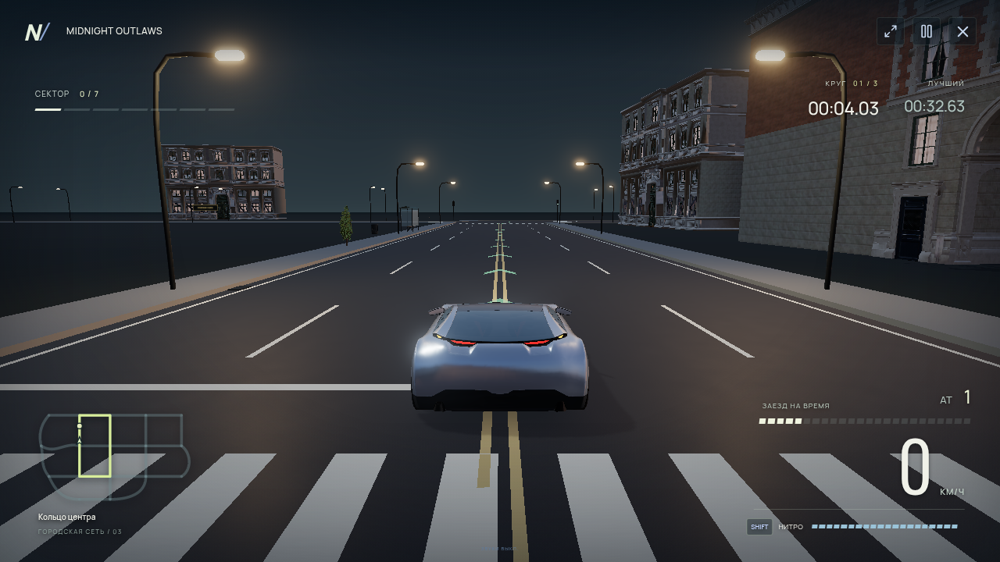

## Изгиб дороги и траектория

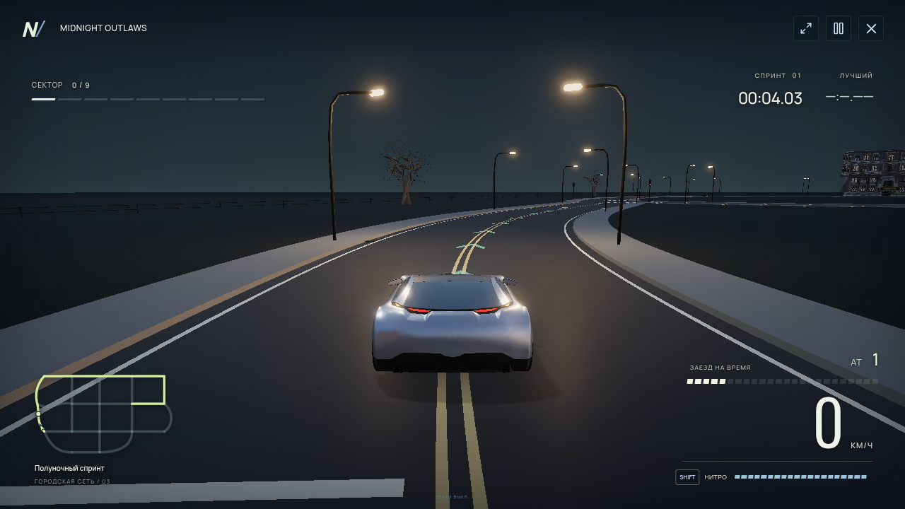

## Перекрёсток, разрывы линий и выбранный путь

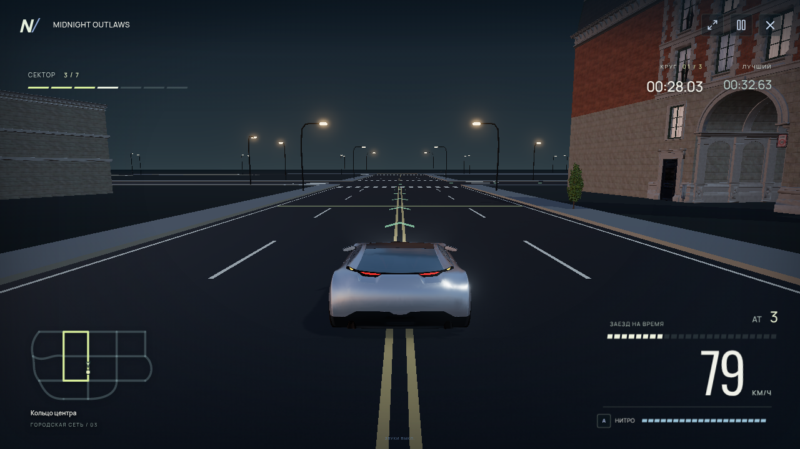

## Автомобиль — Close Chase

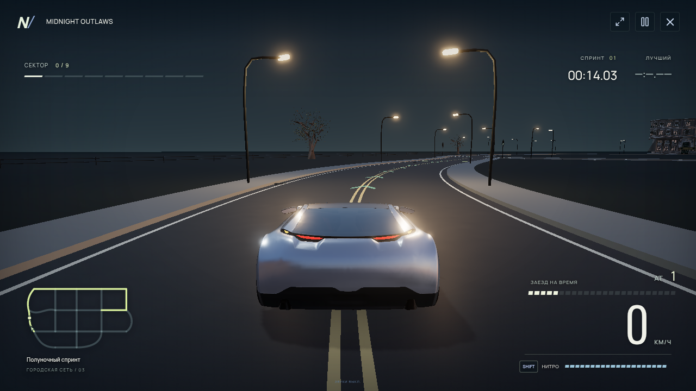

## Начало промышленного маршрута

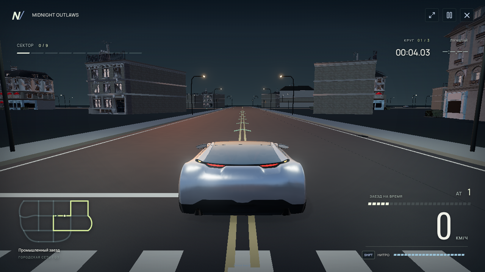

## Выбор трассы и карта сети

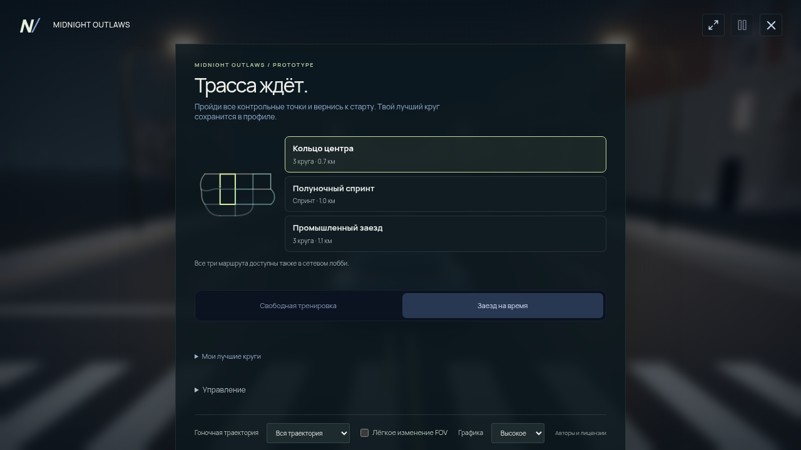

## Контакт с окружением

Отдельная функциональная запись: Low, viewport 1280×720, DPR 0,5, фактический снимок 640×360. Состояние после зарегистрированного удара и торможения; полный момент удара показан в видео. [Реальные импульсы](collision-report.json).

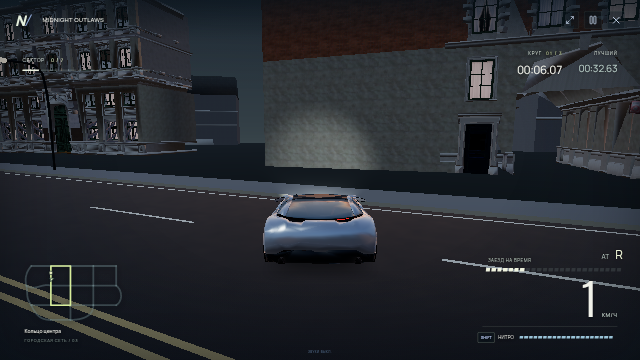

## Камера при разгоне

Medium, DPR 0,5. Дистанция 7,8 м, FOV 58°. [Измеряется проекция GLB-границ](camera-report.json), не сегментация пиксельного силуэта. Это реальные кадры игрового разгона и торможения. Числовая проекция измерена при 0/50/100/151 км/ч; асинхронный GPU-захват последнего снимка показывает 148 км/ч. Снимки не подменяют измерение точным моментом.

### 0 км/ч

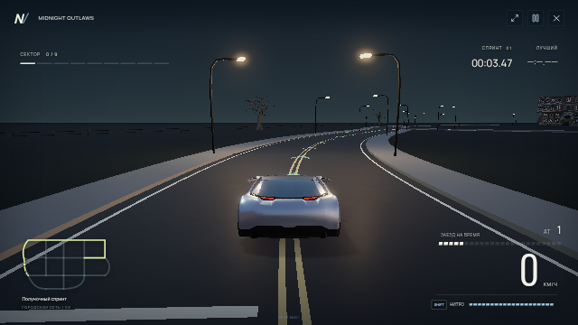

### 50 км/ч

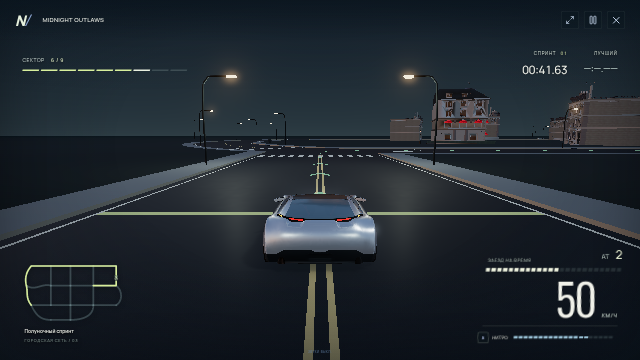

### 100 км/ч

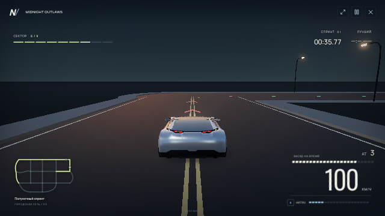

### Разгон до 150 км/ч — 148 км/ч в захваченном кадре

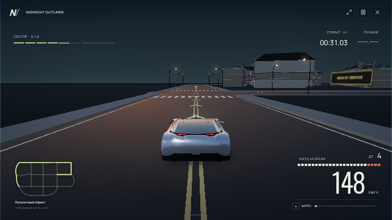

## Оценка визуальной проверки

Разметка следует изгибу дороги, пересечения не имеют наложенных асфальтовых плоскостей. Траектория читается впереди машины и не закрывает её силуэт. Масштаб автомобиля сохраняется при разгоне; колёса находятся у покрытия. В подборке видны остающиеся ограничения: глухие фасады, открытые промежутки между кварталами и небольшой набор архитектурных моделей. Это не заявление о достижении AAA-уровня или аппаратных 60 FPS.
