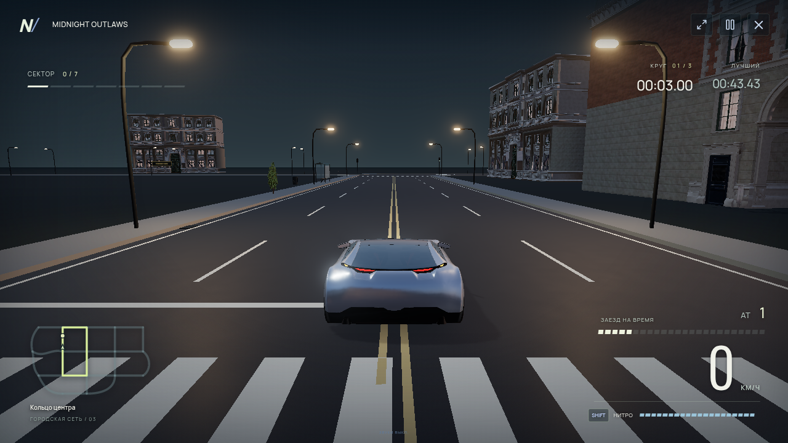
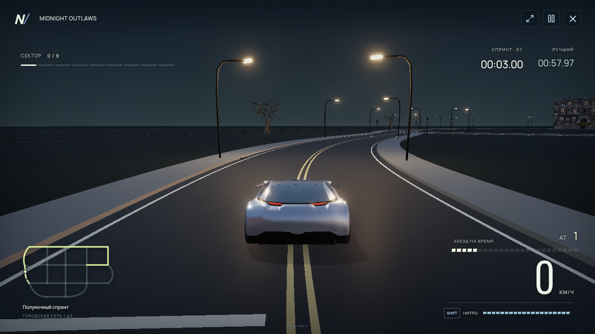
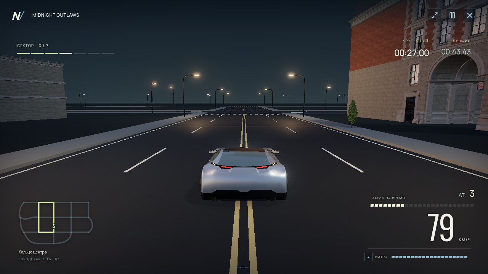
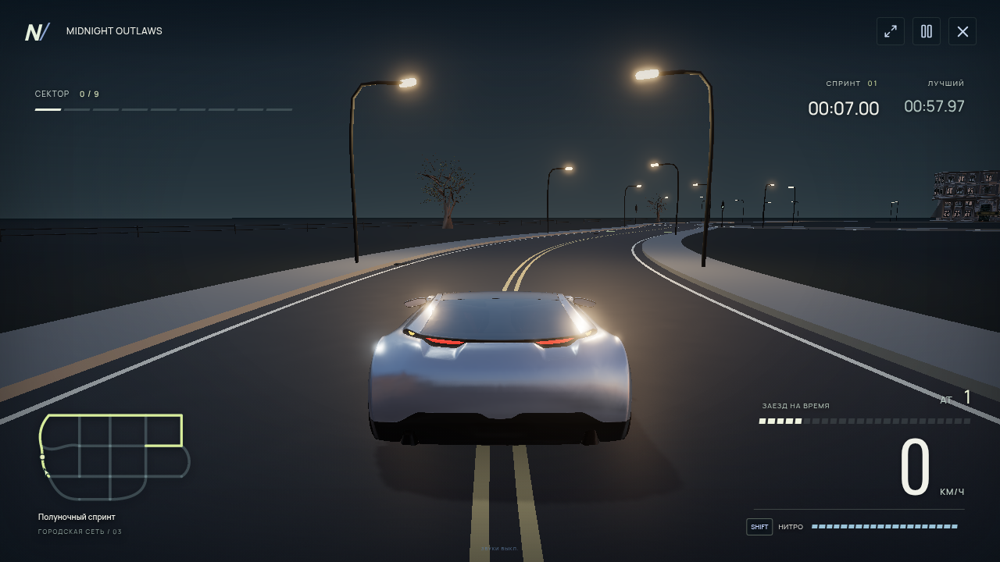
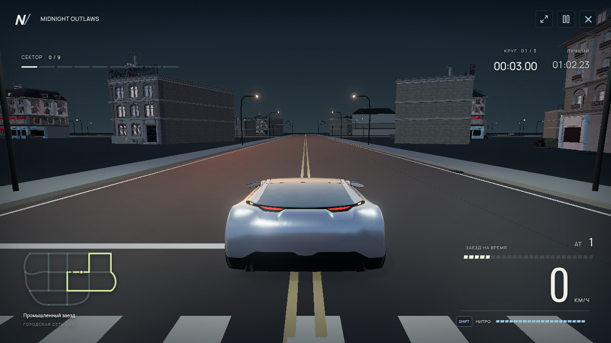
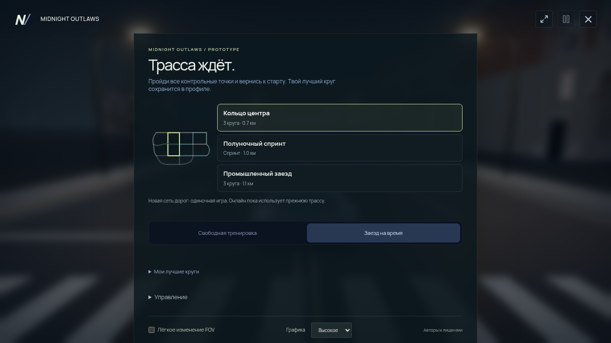
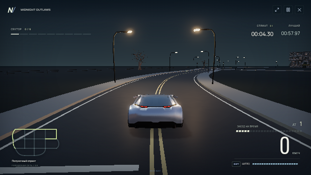
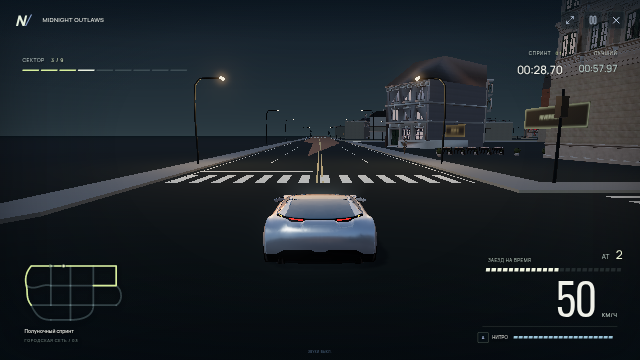
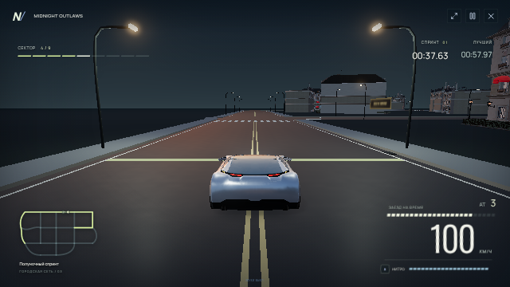
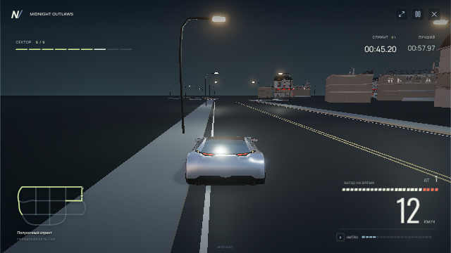

# Реальный рендер MIDNIGHT OUTLAWS

Снимки сделаны из запущенной игры Three.js/GLB в Chromium. Это не концепт-арт и не сгенерированные изображения. High, 1280×720, DPR 1; программный SwiftShader. Снимки не подтверждают производительность физического GPU.

[Видео реального процесса — MP4](gameplay.mp4) · [Измерения FPS](performance.md) · [Протокол снимков](screens-report.json)

## Разметка прямого участка

## Разметка на повороте

## Настоящий перекрёсток городской сети

## Автомобиль в Close Chase

## Промышленный район

## Мини-карта и выбор трёх маршрутов

## Камера во время реального разгона

Дистанция 7,8 м, FOV 58°. [Измеряется проекция границ GLB](camera-report.json); это не сегментация пиксельного силуэта. Последний снимок сделан при 151 км/ч.

### 0 км/ч

### 50 км/ч

### 100 км/ч

### 150 км/ч

